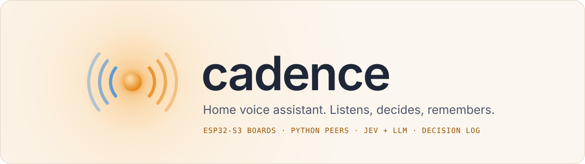
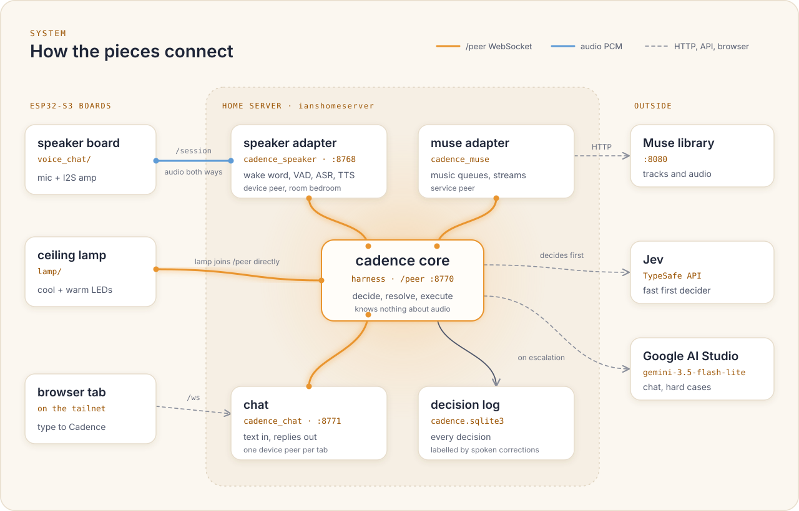
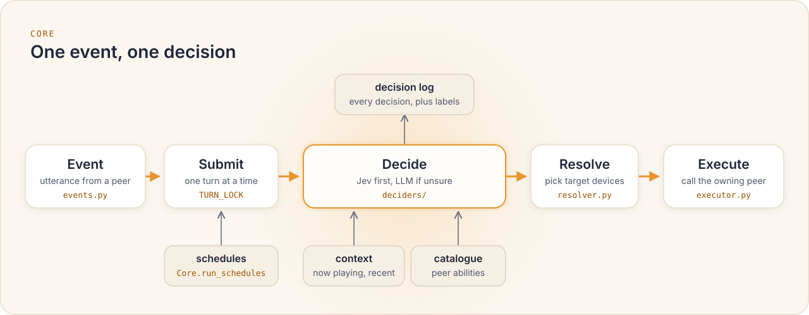

<p align="center"></p>

A home voice assistant. You talk to an ESP32-S3 speaker ("hey jarvis, play some jazz", "dim the lights"), and Cadence works out what you meant and makes it happen: music from a Muse library, a ceiling lamp, schedules, spoken replies. Every decision goes into a log, and spoken corrections label it, so the decision layer can be fine-tuned and later run locally.

The repo holds three Python programs (the core and two adapters), a text chat page, and four ESP-IDF firmware projects for the same ESP32-S3 board.

## System overview

<p align="center"></p>

The core knows nothing about audio. Everything that touches the outside world joins the core over one WebSocket, `/peer`, as either a **device** (has a room: the speaker, the lamp, a chat tab) or a **service** (no room: Muse). Each peer's `hello` declares its abilities, and the core builds its capability catalogue and device registry from them.

## One spoken turn

1. The board streams mic audio (16 kHz s16le mono) to the speaker adapter.
2. The speaker adapter hears "hey jarvis", cuts the phrase with VAD, and turns it into text with Whisper.
3. It sends an `utterance` event to the core.
4. The core asks Jev. Low confidence, missing args, chat, a correction, or Jev being down sends it to the LLM instead.
5. The core picks the target devices, writes the decision log, and sends a `call` to the peer that owns the ability (`music.play`, `light.set`, ...).
6. The speaker adapter plays an ack clip or Kokoro speech back to the board (44.1 kHz s16le stereo), with music ducked underneath.

## Inside the core

<p align="center"></p>

A spoken correction ("no, I meant the other one") labels the previous decision `wrong` in `decision_labels`. The speaker is the only input; there is no app or button for labels.

## Repository layout

| Path | What it is |
|---|---|
| `harness/` | Cadence core (Python): decisions, schedules, decision log. See `harness/README.md`. |
| `speaker/` | `cadence_speaker`: board-facing adapter. Wake word, VAD, ASR, TTS, acks, music ducking. See `speaker/README.md`. |
| `muse_adapter/` | `cadence_muse`: service peer for Muse (music queues, stream URLs) and its MCP server. See `muse_adapter/README.md`. |
| `chat/` | `cadence_chat`: text chat page; each browser tab is a `chat` device peer. See `chat/README.md`. |
| `voice_chat/` | Firmware: speaker TX and mic RX at once; client of `/session`. |
| `lamp/` | Firmware: CCT lamp (cool GPIO4, warm GPIO2), joins `/peer` directly, ability `light.set`, OTA on boot. |
| `main/`, `CMakeLists.txt` | Root firmware: plays a raw PCM HTTP stream from `tools/muse_proxy.py` out I2S. |
| `mic_test/` | Firmware: INMP441 mic amplitude meter over serial, for bench tests. |
| `tools/` | `muse_proxy.py` (ffmpeg transcoder for the root firmware), Kokoro model files. |
| `docs/` | `prd/`, `specs/`, `plans/`, `research/`, `preflight/`, `handoffs/`, `hardware/` (build log and inventory). |

## Board wiring (speaker + mic)

| Signal | Speaker (TX) | INMP441 mic (RX) |
|---|---|---|
| I2S peripheral | `I2S_NUM_0`, master | `I2S_NUM_1`, master |
| BCLK / SCK | GPIO15 | GPIO5 |
| WS (LRCLK) | GPIO16 | GPIO6 |
| Data | GPIO17 (`dout`) | GPIO4 (`din`) |
| Format | 16-bit stereo, 44.1 kHz | 32-bit mono (left slot), 16 kHz |

Mic `VDD` is 3.3 V, never 5 V; `L/R` is tied to GND. The lamp uses GPIO4 (cool) and GPIO2 (warm) on its own board.

## Run

One venv (`harness/.venv`, Python 3.14 or newer) serves every Python program. Setup, API keys, and Kokoro model downloads are in `harness/README.md`. Start each program from its own directory:

```
cd harness      && .venv/bin/python -m cadence                    # core, /peer on 8770
cd muse_adapter && ../harness/.venv/bin/python -m cadence_muse    # Muse service peer
cd speaker      && ../harness/.venv/bin/python -m cadence_speaker # /session on 8768
cd chat         && ../harness/.venv/bin/python -m cadence_chat    # optional, :8771
```

The host clock is UTC; run the core with `TZ=Asia/Seoul` so schedules use local time.

Firmware (ESP-IDF v5.3), from inside the project directory you want:

```
source ~/esp/esp-idf/export.sh
idf.py set-target esp32s3   # once per project
idf.py -p /dev/ttyACM0 flash monitor
```

`voice_chat/` and `lamp/` read WiFi credentials from a gitignored `sdkconfig.defaults.local` you create by hand (keys in `CLAUDE.md`); the root firmware still keeps them in `sdkconfig.defaults`. Flashing one project replaces whatever is on the chip.

## Tests

```
cd harness      && .venv/bin/python -m pytest
cd speaker      && ../harness/.venv/bin/python -m pytest
cd muse_adapter && ../harness/.venv/bin/python -m pytest
```
